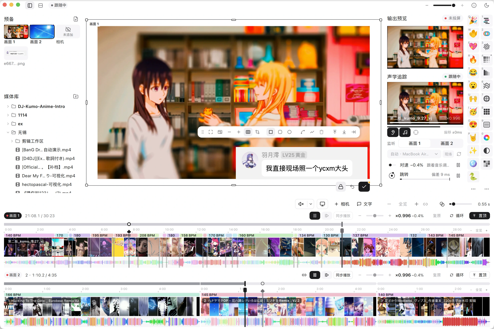

<div align="center">
  <h1>
    Kumo's<br>
    <em>Video Jockey</em>
  </h1>

  <p>
    
    <a href="https://github.com/kumoSleeping/KVJ/releases"></a>
    
    
    
  </p>

  <br>

  
</div>

---

[中文](README.md) · **English**

KVJ is live VJ software for DJs. It listens: **acoustic tracking** (声学追踪) knows which song the DJ is playing and where, and keeps the video with the music by itself. It is also a handy video player: two tracks, laid out on a board as the picture the audience sees, with danmaku, reactions, stickers and effects over it. macOS and Windows.

## Download & install

This is a preview (pre-release) build; every version is listed under [Releases](https://github.com/kumoSleeping/KVJ/releases).

<!-- release-package-size-badges:start -->
<p>
  <a href="https://github.com/kumoSleeping/KVJ/releases/latest/download/KVJ-macos-arm64.dmg"></a>
  <a href="https://github.com/kumoSleeping/KVJ/releases/latest/download/KVJ-windows-x64.zip"></a>
  <a href="https://github.com/kumoSleeping/KVJ/releases"></a>
</p>
<!-- release-package-size-badges:end -->

- **macOS**: open the DMG and drag KVJ into Applications. The app is not notarized; if macOS blocks the first launch, allow it under System Settings → Privacy & Security. Capturing system sound needs macOS 14.2 or later (screen-recording capture from 12.3); allow the microphone or system audio recording when KVJ first listens.
- **Windows**: unzip and run `bin\KVJ.exe`. If Windows reports a missing runtime, run `vc_redist.x64.exe` from the same folder first.

## Features

### Acoustic tracking: pictures matched to the music, by ear

KVJ listens to the music the DJ is playing, recognizes which video in the library it belongs to and where it is, and plays that video from that point at the same speed. When the DJ speeds up or slows down, the picture's speed changes with it; when the DJ jumps to another part of the song or to another song, the picture jumps there too, after checking once more so that it does not cut by mistake. Repeated choruses and other similar passages are told apart. It works from the sound alone: no connection to the DJ software, no MIDI and no cue points set in the videos beforehand; it can listen to the Master, the system's sound or a microphone, and room mode helps with a microphone in a noisy room. The VJ no longer has to watch the DJ and line the picture up by hand, and speed and jumps can each be paused to take control back at any time.

[More about acoustic tracking →](docs/acoustic-tracking.md) (Chinese)

### Player

- At the left are the **library** (folders added, files never copied) and **预备** (ready: sources not on the picture yet, and pictures kept for stickers). A video dropped on a track's left half replaces what is there, on its right half it goes after it.
- Two tracks at the foot, **画面 1** and **画面 2**, as in a video editor: frame strips, KDJ's whole-track preview waveform and BPM sections, each with its own time, zoom and speed; they can **play in sync**, **change speed together** and **zoom together**, or one alone is shown (single track).
- Pressing a track only places its **cursor** and never moves the picture; **跳至** (jump) or Enter plays from it. Every jump can dissolve.
- Speed goes from −50 % to +50 %; ← / → **nudge** the picture like a pitch bend (0.7× / 1.5× while held), ↑ / ↓ change it by 1 %.
- Each track's own sound can be on with its own volume (a cue mix), stretched by Rubber Band with its pitch kept; or only the topmost track's is heard.
- Built for the show: the computer and its screens stay awake, and closing the window while listening or projecting asks first; decoder failures, a sound output that will not start, a lost projector screen, a lost file and a broken sound input all recover by themselves; video is decoded by the system hardware and decoded and drawn only when needed, so the load stays low.

### Board and 投放

- The **board** in the middle is the audience's picture, seen and made in one place: 画面 1, 画面 2 and cameras are **layers** that are moved, sized, raised, filled or fitted, rounded, masked to a circle, feathered and cut by **split lines**. Around the picture is the **offstage** area, which the audience does not see.
- The board has two modes: in **实时** (live) every change is on the air at once; in **投放** (staged) the audience keeps the picture last put out until **投放** (or Space) puts the new one out, with a dissolve if wanted, and ⌘Z **undoes** the board back to what is on the air. **输出预览** at the top right always shows what the audience sees.
- A track's **投放画面 N** cuts that track to the top in one press; with **跳转置顶** on, a jump first puts its track on top and then plays.

### Overlay and effects

- Danmaku (scrolling, top or bottom, laned as on Bilibili), large words in the middle, and Google Meet–style reactions (Noto's animated emoji; hold to send a stream, Q–P send one each).
- Stickers of images, GIFs and words, moved, sized, turned and taken down on the board; the audience's picture follows.
- A dozen picture effects (glitch, RGB split, zoom blur, halftone, posterize, video wall, wave, scanlines, mosaic, black and white, lens…) form an **effect chain**: they apply from the top down, each to the picture the ones above made, are reordered by dragging (kept between runs), keyed on at their best strength, and the number keys 1–0 switch the first ten. Effects touch only the picture, never the danmaku, reactions or stickers.

### Cameras (experimental)

- **+ 相机** puts a camera's picture on the board as a layer like 画面 1 and 画面 2: moved, sized, masked, raised, or put back in 预备.
- A camera that goes away for a moment keeps its place and says what is wrong, and comes back by itself; a camera the system will not give never freezes KVJ.

## Documents

- [Acoustic tracking](docs/acoustic-tracking.md) (Chinese): what it does, how to use it, how it works.
- [Glossary](docs/glossary.md) (Chinese): KVJ's terms.
- [Design principles](docs/principles.md) (Chinese): the choices that run through the whole app.
- [Detailed guide](docs/guide.md): every detail of using it.

## Build from source

Needs Rust (stable), CMake ≥ 3.22, Ninja and Qt 6.8 with Qt Shader Tools and Qt Image Formats.

```sh
cargo test -p kvj-recognize -p kvj-engine
cmake -S app -B build -G Ninja -DCMAKE_BUILD_TYPE=Release -DCMAKE_PREFIX_PATH=<Qt>/6.8.3/<platform>
cmake --build build
cmake --install build --prefix dist   # bundles Qt next to the app
```

On Windows run these from a Visual Studio developer prompt.

## License

KVJ is released under the [GNU GPL 3.0 or later](LICENSE); its acoustic tracking code is ported from [KDJ](https://github.com/kumoSleeping/KDJ). Release builds statically link the GPL-2.0-or-later
Rubber Band Library; its source and license are kept in
[`vendor/rubberband`](vendor/rubberband), and other notices are in
[`THIRD_PARTY_NOTICES.md`](THIRD_PARTY_NOTICES.md).
